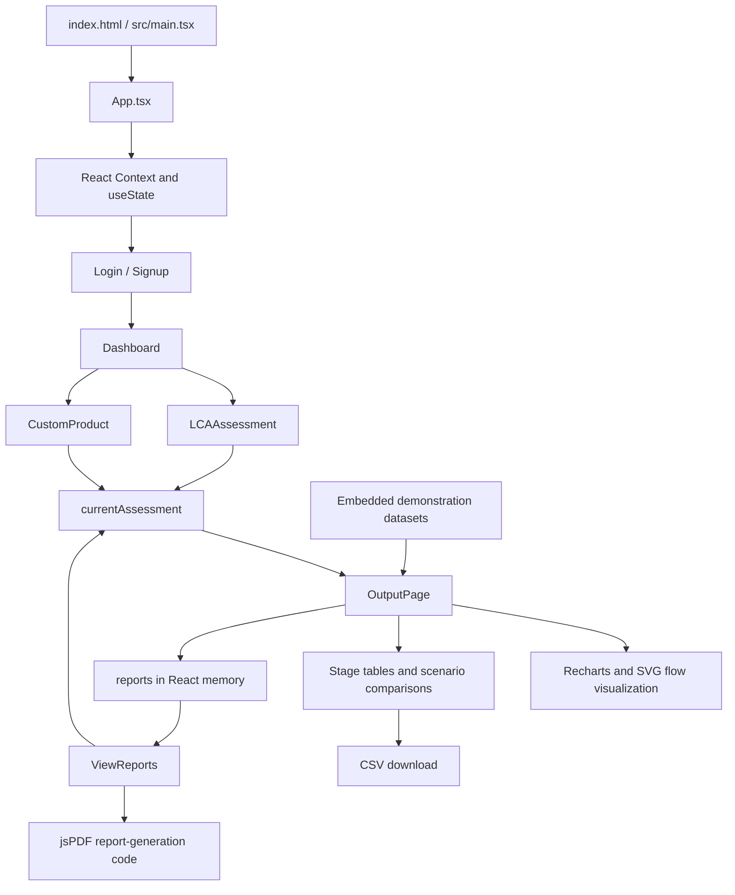

# ECOCYCLE — ALUMINIUM LIFE CYCLE ANALYSIS
### Frontend Dashboard for Manufacturing & Environmental Analytics


An interactive React application for configuring aluminium products, exploring life cycle indicators, comparing production scenarios, and presenting assessment reports.

**2 standard products · Custom product configuration · 6 result views · Transportation segments**

**Branch:** `Frontend_Lca`  
**Related backend and ML workflow:** [`main`](https://github.com/GAUM-G/Aluminium-Life-Cycle-Analysis/tree/main)

---

## Table of Contents

- [1. Project Overview](#1-project-overview)
- [2. Problem Statement](#2-problem-statement)
- [3. Project Objectives](#3-project-objectives)
- [4. Key Features](#4-key-features)
- [5. Architecture & System Design](#5-architecture--system-design)
- [6. Application Flow & State](#6-application-flow--state)
- [7. Product & Transportation Configuration](#7-product--transportation-configuration)
- [8. Analytics & Visualization](#8-analytics--visualization)
- [9. Reports & Exports](#9-reports--exports)
- [10. Data & Backend Integration](#10-data--backend-integration)
- [11. Technology Stack](#11-technology-stack)
- [12. Installation & Local Setup](#12-installation--local-setup)
- [13. Screens & Navigation](#13-screens--navigation)
- [14. Configuration Reference](#14-configuration-reference)
- [15. Repository Structure](#15-repository-structure)
- [16. Verification & Current Limitations](#16-verification--current-limitations)
- [17. Future Development](#17-future-development)
- [18. Attribution & License](#18-attribution--license)

---

## 1. Project Overview

**EcoCycle** is the frontend presentation layer of the Aluminium Life Cycle Analysis project. It provides product assessment forms, environmental and cost visualizations, scenario comparison, and an in-session report history.

The interface covers aluminium pipes, sheets, and custom products. Users can enter dimensions, select manufacturing and energy options, add transportation segments, and explore a structured results workspace.

| Repository branch | Responsibility |
| :--- | :--- |
| **`Frontend_Lca`** | React/Vite application, configuration forms, charts, report UI, and browser exports. |
| **`main`** | Separate Python/Flask baseline engine, model-training scripts, datasets, and saved ML evaluation results. |

> **Current implementation:** this branch is a standalone frontend prototype. Login is simulated, assessments are stored in React memory, and the result screens use embedded demonstration values. There is no active connection to the Flask API or trained model predictors.

## 2. Problem Statement

Environmental assessments can involve several indicators at once: electricity, carbon emissions, wastewater, natural gas, production cost, and transport. Product specifications and manufacturing choices add further complexity.

EcoCycle organizes these inputs and outputs into a single workflow:

```text
Product configuration -> Scenario selection -> Results workspace -> Report history
```

The goal is to make an assessment easier to configure, inspect, compare, and communicate through a consistent interface.

## 3. Project Objectives

1. **Structured input:** collect product dimensions, quantity, manufacturing route, energy source, and end-of-life choices.
2. **Scenario exploration:** present conventional and recycled production comparisons.
3. **Visual communication:** organize environmental and cost indicators into charts and stage tables.
4. **Reporting:** support report history, detailed review, and export interfaces.
5. **Modular frontend:** separate forms, navigation, results, and reusable UI components for future backend integration.

## 4. Key Features

| Module | Implemented interface |
| :--- | :--- |
| **Login and signup** | Form-based demonstration login and account creation screens. |
| **Dashboard** | Assessment count, summary cards, and navigation shortcuts. |
| **Standard assessment** | Pipe/sheet selection, dimensions, quantity, bauxite grade, route, energy, and end-of-life options. |
| **Transportation** | Multiple segments with mode and distance inputs. |
| **Custom products** | Dimensions, density, metal percentage, alloy-series selection, and scenario inputs. |
| **Results workspace** | LCA, breakdown, decarbonization, comparisons, visualization, and reports tabs. |
| **Visualization** | Recharts-based charts and a custom SVG Sankey-style diagram. |
| **Reports** | In-session history, reopening assessments, CSV export, and jsPDF-based report-generation code. |
| **Layout** | Collapsible sidebar coordinated with page width, branded navigation, and animated transitions. |

See [Reports & Exports](#9-reports--exports) for the distinction between implemented CSV download, PDF-generation code, and placeholder buttons.

## 5. Architecture & System Design



The diagram describes the frontend implementation. It does not imply a live API, database, or machine learning inference connection.

## 6. Application Flow & State

### User workflow

1. Open the app and enter a username and password to use the simulated login.
2. Navigate to **LCA Assessment** or **Custom Product**.
3. Complete the product and scenario inputs.
4. Submit the form to open the results workspace.
5. Inspect the six result tabs and stage breakdown.
6. Open **View Reports** to revisit assessments created during the current session.

### State ownership

`src/App.tsx` provides the application context:

| State | Purpose |
| :--- | :--- |
| `user` | Demonstration username/email used by the layout. |
| `currentPage` | Selects the active screen. |
| `currentAssessment` | Holds the assessment being viewed. |
| `reports` | Holds assessment records created in the current session. |
| `sidebarExpanded` | Keeps sidebar size and main-content spacing synchronized. |

Navigation is controlled through React state, rather than URL-based routing. Reloading the page resets the session because a persistent database or browser-storage layer is not implemented.

## 7. Product & Transportation Configuration

### Standard assessments

| Input | Available configuration |
| :--- | :--- |
| Product | Aluminium pipe or aluminium sheet. |
| Quantity | Positive integer input, with a form limit of 1,000,000. |
| Pipe geometry | Outer radius, inner radius, and length. |
| Sheet geometry | Thickness, width, and length. |
| Manufacturing route | Conventional or recycled. |
| Bauxite grade | Low, medium, or high. |
| Energy source | Renewable or non-renewable. |
| End of life | Recycle, reuse, or landfill. |

Standard product dimensions are entered in **metres**. The form includes required-field and positive-value checks; these are not a substitute for physical geometry validation.

### Transportation segments

Users can add multiple transport legs, each with:

- A mode: **roadways, railways, waterways, or airways**.
- A positive distance in kilometres.

The form collects these segments, but they are not currently used to calculate live emissions or costs.

### Custom product configuration

The custom-product form adds:

- Product naming and alloy-series selection.
- Length, width, and thickness inputs in millimetres.
- Material density and metal-percentage inputs.
- Manufacturing, energy, end-of-life, and transport settings.
- An optional CSV-upload presentation area.

Custom dimensions are converted from millimetres to metres when the assessment object is constructed. The CSV area is currently a UI element; a working CSV import/parser workflow is not implemented.

## 8. Analytics & Visualization

The output workspace exposes six views:

| View | Content |
| :--- | :--- |
| **LCA** | Summary indicators and stage-level environmental presentation. |
| **Breakdown** | Manufacturing-stage tables, per-unit/batch figures, and CSV export. |
| **Decarbonization** | Illustrative reduction opportunities and scenario explanations. |
| **Comparisons** | Conventional versus recycled route indicators, cost, quality, and recyclability. |
| **Visualization** | Charts and Sankey-style flows connecting stages to impact categories. |
| **Reports** | Consolidated presentation of assessment sections and report actions. |

### Displayed indicators

| Indicator | Meaning in the interface |
| :--- | :--- |
| Electricity | Energy-demand presentation in kWh. |
| Carbon | Carbon-emission presentation in kg. |
| Wastewater | Wastewater presentation in litres. |
| Natural gas | Gas-use presentation in stage tables and visualizations. |
| Manufacturing and transport cost | Cost breakdown, with rupee displays in the results. |
| Quality and recyclability | Illustrative route-comparison scores. |

**These are demonstration values.** `OutputPage.tsx` contains fixed per-unit values and a fixed 900-unit example. Changing the assessment quantity or dimensions does not produce a validated recalculation of those totals. Some Sankey quantities are derived using mock formulas, and dashboard summary cards use simple report-count heuristics.

## 9. Reports & Exports

| Action | Current implementation |
| :--- | :--- |
| Assessment history | Stored in the `reports` array while the app is open. |
| Reopen a report | Sets the selected assessment and returns to the output screen. |
| Breakdown CSV | Builds CSV text, creates a browser Blob, and downloads it. |
| History-page PDF | `ViewReports.tsx` contains jsPDF/jsPDF-AutoTable table and document-generation code. |
| Output-page PDF actions | Some buttons only display a success alert; they do not create a PDF. |

The history-page PDF content uses embedded example values. Its code is included in the successful build, but download behavior and plugin compatibility have not been verified in a browser.

Reports are not uploaded to a server, saved to a database, or retained after a page reload.

## 10. Data & Backend Integration

### Current data flow

```text
User inputs -> React assessment object -> Result screen
                                         +
                               Embedded example data
```

This branch contains no active API request or model-loading path. Python model accuracy scores belong to the [backend/ML branch](https://github.com/GAUM-G/Aluminium-Life-Cycle-Analysis/tree/main); they are not frontend performance benchmarks.

### Planned integration boundary

A future adapter can translate the frontend form into the Flask `POST /compute` request and map the response into the charts and report tables. The current structures are not interchangeable:

| Frontend field | Backend mapping required |
| :--- | :--- |
| Product UI value | Translate to backend `pipe` or `sheet`. |
| `route` | Map to `route_type`. |
| `energySource` | Map to `energy_source` and align accepted category labels. |
| `bauxiteGrade` | Map to `bauxite_grade`. |
| `endOfLife` | Map to `eol_option`. |
| `dimensions` | Expand into the backend's individual dimension fields in metres. |
| Transportation and metal percentage | Define backend calculation support; collecting the inputs alone does not implement it. |

The backend currently provides baseline/stage estimates. Connecting this frontend to that endpoint would not, by itself, connect the trained regression predictors.

## 11. Technology Stack

| Layer | Libraries / tools |
| :--- | :--- |
| UI framework | React 18.3 |
| Source language | TypeScript / TSX |
| Build and development server | Vite 6.3.5, React SWC plugin |
| UI primitives | Radix UI and shadcn/ui-style components |
| Styling | Tailwind-style utility CSS and project stylesheets |
| Animation | Motion |
| Charts | Recharts |
| Icons | Lucide React |
| PDF-generation code | jsPDF and jsPDF-AutoTable |
| State | React Context and hooks |
| Dependency management | npm and `package-lock.json` |

## 12. Installation & Local Setup

### Prerequisites

- Node.js and npm.
- A modern browser.

The local build was verified with **Node.js 22.23.1** and **npm 10.9.8**.

### Clone the frontend branch

```powershell
git clone --branch Frontend_Lca --single-branch https://github.com/GAUM-G/Aluminium-Life-Cycle-Analysis.git FRONTEND_LCA
cd FRONTEND_LCA
npm ci
npm run dev
```

If the folder is already on your machine, open `FRONTEND_LCA` and run the last two commands. If its dependencies are already installed, `npm run dev` is enough.

The configured development address is **http://localhost:3000**. Vite opens the browser automatically and may choose another port if 3000 is occupied; use the address printed in the terminal.

### Demonstration sequence

1. Enter any nonempty username and password on the mock login screen.
2. Open **LCA Assessment**.
3. Select a product and complete the required options, dimensions, and transportation details.
4. Submit and explore the result tabs.
5. Use **View Reports** to reopen the assessment or inspect report actions.

No real account, Python process, database, or API key is required to run this frontend demo.

### Production build

```powershell
npm run build
```

Generated assets are written to **`build/`**, as configured in `vite.config.ts`. Build output and installed dependencies are ignored by Git.

## 13. Screens & Navigation

The application switches among these state keys; they are not separate URL routes:

| State key | Component | Purpose |
| :--- | :--- | :--- |
| `login` | `LoginPage.tsx` | Demonstration login. |
| `signup` | `SignupPage.tsx` | Demonstration signup with password confirmation. |
| `dashboard` | `Dashboard.tsx` | Overview cards and shortcuts. |
| `lca-assessment` | `LCAAssessment.tsx` | Standard product assessment form. |
| `custom-product` | `CustomProduct.tsx` | Custom product configuration. |
| `output` | `OutputPage.tsx` | Results and report views. |
| `view-reports` | `ViewReports.tsx` | Current-session assessment history. |

`Navbar.tsx` and `Sidebar.tsx` provide the shared authenticated-demo layout.

## 14. Configuration Reference

| Setting | Value / location |
| :--- | :--- |
| Development port | `3000` in `vite.config.ts`. |
| Automatic browser opening | `server.open: true`. |
| Build directory | `build/`. |
| Build target | `esnext`. |
| Source alias | `@` resolves to `src/`. |
| Figma asset alias | Maps the exported logo reference to the local PNG under `src/assets/`. |
| Available npm scripts | `dev` and `build`. |
| Runtime configuration | No API URL or application environment-variable layer is currently implemented. |

Keep the Figma asset alias when reorganizing imports; several components reference it for the logo. There is no configured test, lint, or type-check npm script.

## 15. Repository Structure

```text
FRONTEND_LCA/
├── README.md                         # Frontend documentation
├── .gitignore                        # Dependencies/build/local-file exclusions
├── index.html                        # Browser entry document
├── package.json                      # Dependencies and npm scripts
├── package-lock.json                 # Locked dependency tree
├── vite.config.ts                    # Port, asset aliases, and build settings
└── src/
    ├── main.tsx                      # React mounting point
    ├── App.tsx                       # Context, state, navigation, and layout
    ├── index.css                     # Utility and application CSS
    ├── Attributions.md               # Existing component/image credits
    ├── assets/                       # EcoCycle logo
    ├── components/
    │   ├── LoginPage.tsx              # Mock login
    │   ├── SignupPage.tsx             # Mock signup
    │   ├── Dashboard.tsx              # Session overview
    │   ├── LCAAssessment.tsx          # Standard product/transport form
    │   ├── CustomProduct.tsx          # Custom product form
    │   ├── OutputPage.tsx             # Charts, stage tables, comparisons, CSV
    │   ├── ViewReports.tsx            # Report history and PDF-generation code
    │   ├── Navbar.tsx                # Shared top navigation
    │   ├── Sidebar.tsx               # Collapsible navigation
    │   ├── figma/                    # Exported image helper
    │   └── ui/                       # Reusable UI primitives
    ├── styles/globals.css            # Theme and base styles
    └── guidelines/Guidelines.md      # Original design guidelines
```

## 16. Verification & Current Limitations

### Verified

`npm run build` completed successfully using the existing local dependencies and produced the frontend assets in `build/`.

Vite reported a bundle-size warning: the largest JavaScript chunk is approximately **1.32 MB before gzip**. This is a performance optimization opportunity; the build succeeded.

### Boundaries

1. **Simulated authentication:** login/signup do not validate or create server accounts.
2. **Demonstration analytics:** result totals and comparisons are embedded examples, including a fixed 900-unit dataset.
3. **No persistent storage:** assessments and user state reset on reload.
4. **No live backend:** this branch does not call the Flask API or trained models.
5. **Partial exports:** CSV download is implemented; some PDF buttons are placeholders, and history PDF generation needs browser verification.
6. **Partial inputs:** transport segments and metal percentage are collected but not connected to validated calculations; CSV import is not implemented.
7. **Validation gaps:** form checks do not cover all physically invalid geometries or runtime data contracts.
8. **Verification scope:** a successful Vite build is not a full TypeScript check, browser test suite, or scientific validation.

## 17. Future Development

- Define a shared assessment contract and connect the Flask calculation API.
- Replace fixed result objects with returned calculation data.
- Implement authenticated sessions and persistent report storage.
- Connect transport, composition, and custom-product inputs to validated calculations.
- Complete PDF actions, verify plugin integration, and implement CSV import.
- Add URL routing, type checking, accessibility checks, and browser tests.
- Split heavy report/chart code into lazy-loaded chunks to improve loading performance.

## 18. Attribution & License

The original code bundle identifies its design source as [EcoCycle Website Development on Figma](https://www.figma.com/design/NTxoaISuYu0FKWCu8aBne1/EcoCycle-Website-Development).

Existing credits in [`src/Attributions.md`](src/Attributions.md) reference shadcn/ui components and Unsplash images. Preserve the relevant third-party attribution and licensing requirements when distributing the project.

**Project license:** no standalone project license has been selected or added to this branch.
