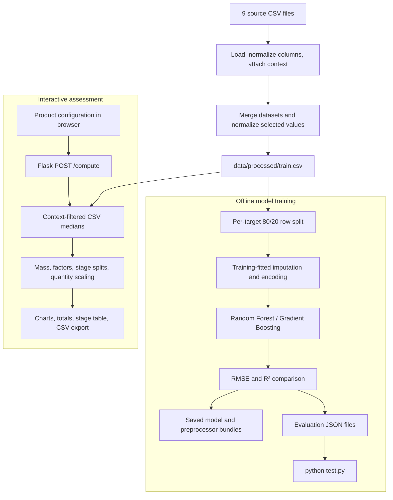

# ALUMINIUM LCA
### Environmental Impact Assessment & Manufacturing Analytics


A Flask dashboard and machine learning workflow for exploring energy consumption, emissions, wastewater, and manufacturing costs across aluminium production scenarios.

**2 product types · 6 regression targets · 9 source CSVs · 8,850 merged records**

---

## Table of Contents

- [1. Project Overview](#1-project-overview)
- [2. Problem Statement](#2-problem-statement)
- [3. Project Objectives](#3-project-objectives)
- [4. Key Features](#4-key-features)
- [5. Architecture & System Design](#5-architecture--system-design)
- [6. Request Lifecycle](#6-request-lifecycle)
- [7. Product Geometry & Stage Engine](#7-product-geometry--stage-engine)
- [8. Dataset & Preprocessing](#8-dataset--preprocessing)
- [9. Model Training & Selection](#9-model-training--selection)
- [10. Performance Benchmarks](#10-performance-benchmarks)
- [11. Understanding the Results](#11-understanding-the-results)
- [12. Technology Stack](#12-technology-stack)
- [13. Installation & Local Setup](#13-installation--local-setup)
- [14. API & Output Reference](#14-api--output-reference)
- [15. Configuration Reference](#15-configuration-reference)
- [16. Repository Structure](#16-repository-structure)
- [17. Verification & Current Limitations](#17-verification--current-limitations)
- [18. Future Development](#18-future-development)
- [19. Repository Hygiene & License](#19-repository-hygiene--license)

---

## 1. Project Overview

**Aluminium LCA** brings product configuration, manufacturing-stage estimates, route comparison, and regression model evaluation into one repository. It supports aluminium **pipes** and **sheets**, allowing users to explore how geometry, quantity, energy source, production route, and end-of-life choices affect estimated outcomes.

The implementation has two operational paths:

| Path | Implementation | Output |
| :--- | :--- | :--- |
| **Interactive assessment** | Flask API, CSV median baselines, geometry calculations, and fixed stage factors. | Per-unit and batch estimates, stage charts, route comparisons, and exported CSV data. |
| **Machine learning experiments** | CSV preprocessing, candidate regressors, evaluation, and model serialization. | Six selected model bundles, per-target leaderboards, and R²/RMSE records. |

> **Implementation scope:** the dashboard currently uses the baseline and stage engine. It does not load the trained `.pkl` predictors. The trained regression models are evaluated and saved through the separate training workflow.

## 2. Problem Statement

Aluminium manufacturing involves trade-offs between production cost, energy demand, greenhouse gas emissions, wastewater, and other pollutants. Comparing a conventional route with recycled production requires considering several quantities together, rather than looking at a single carbon or cost figure.

This project provides a local tool to:

- Configure a product and compare manufacturing scenarios.
- Inspect how estimated impacts are distributed across processing stages.
- View environmental and cost indicators together.
- Compare regression algorithms for different numerical prediction targets.

The current system is an exploratory prototype; its estimates are not a certified industrial life cycle inventory.

## 3. Project Objectives

1. **Product-based assessment:** support configurable pipe and sheet dimensions and quantities.
2. **Scenario comparison:** explore conventional/recycled routes and renewable/non-renewable energy choices.
3. **Multiple prediction targets:** train separate regressors for electricity, carbon, cost, wastewater, fluorine, and SO₂.
4. **Transparent evaluation:** record candidate performance, winning models, and usable test sample counts.
5. **Accessible results:** present stage-level information through charts, searchable tables, and exports.

## 4. Key Features

| Module | Implemented capabilities |
| :--- | :--- |
| **Product configuration** | Pipe radii/length; sheet thickness/width/length; batch quantity. |
| **Manufacturing scenarios** | Conventional and recycled routes; high, medium, or low bauxite grade; energy selection. |
| **Stage assessment** | Six pipe stages and five sheet stages, with per-unit and total scopes. |
| **Environmental indicators** | Electricity, carbon, natural gas, wastewater, and end-of-life adjustments. |
| **Cost indicators** | Manufacturing and transport cost estimates. |
| **Interactive dashboard** | Comparison, distribution, process-flow, efficiency, and route-comparison views. |
| **Reporting** | Searchable stage table and CSV export. |
| **Model comparison** | Random Forest and Gradient Boosting; optional XGBoost/LightGBM candidates when installed. |
| **Saved evaluation** | Summary JSON, candidate leaderboards, per-model metrics, and a terminal score viewer. |

## 5. Architecture & System Design

The web assessment and offline model training share the processed dataset, but execute independently.



## 6. Request Lifecycle

When the user selects **Calculate Impact**:

```text
Browser configuration
    -> POST /compute with product and scenario JSON
    -> Load processed CSV
    -> Select median baseline values, relaxing context filters if necessary
    -> Calculate aluminium mass from geometry
    -> Apply route, grade, and energy factors
    -> Apply end-of-life credit
    -> Allocate totals across manufacturing stages
    -> Produce per-unit and batch results
    -> Render charts, summary cards, and detailed table
```

The response includes the selected baseline values so the calculation inputs can be inspected.

## 7. Product Geometry & Stage Engine

### Geometry calculations

The stage engine uses an aluminium density of **2,700 kg/m³**. All dashboard dimensions are entered in metres.

| Product | Mass calculation |
| :--- | :--- |
| Pipe | `mass_kg = π × (outer_radius² − inner_radius²) × length × 2700` |
| Sheet | `mass_kg = thickness × width × length × 2700` |

### Manufacturing stages

| Pipe | Sheet |
| :--- | :--- |
| Casting primary aluminium | Casting primary aluminium |
| Extrusion | Hot rolling |
| Quench | Cold rolling |
| Hot shear | Heat treatment and tempers |
| Finish saw / final cutting | Finishing and surface treatment |
| Aging / heat treatment | — |

### Scenario factors

| Parameter | Factors implemented in the stage engine |
| :--- | :--- |
| Route | Conventional: `1.00`; recycled: `0.65`. |
| Energy | Renewable: `0.85`; other energy values: `1.00`. |
| Bauxite grade | High: `0.95`; medium: `1.00`; low: `1.10`. |
| End of life | Carbon credit: recycle `15%`, reuse `10%`, landfill `0%`; cost receives half that credit rate. |

These are fixed code assumptions. They describe the calculation method, not measured or independently validated savings. Transport uses a separate mass-based calculation. Grade-based quality scores are also assigned constants rather than trained predictions.

## 8. Dataset & Preprocessing

### Source composition

| Source group | Files | Context |
| :--- | ---: | :--- |
| Aluminium sheets | 2 | Renewable and non-renewable energy samples. |
| Aluminium pipes | 2 | Renewable and non-renewable energy samples. |
| Recycled aluminium | 2 | Scrap-route samples. |
| Bauxite | 3 | High-, medium-, and low-grade samples. |
| **Total** | **9** | **8,850 merged records and 154 columns in the current run.** |

`src/data/data_loader.py` defines the required filenames under `data/raw/`. `data/raw2/` contains an alternate local collection and is not loaded by the root training command.

### Preprocessing pipeline

| Step | Implementation |
| :--- | :--- |
| Column normalization | Strip whitespace, lowercase names, replace spaces with underscores. |
| Context enrichment | Attach product, route, energy source, grade, and source labels. |
| Merge | Combine source tables while retaining their available numeric features. |
| Selected unit normalization | Apply magnitude-based scaling to selected energy, carbon, and cost columns. |
| Target filtering | Exclude rows missing the target currently being trained. |
| Numeric features | Training-median imputation, retained empty columns with zero fills, and standard scaling. |
| Categorical features | Fill missing values with `unknown` and apply one-hot encoding. |

The preprocessor is fitted on training rows and reused for test rows. Different targets have different usable sample counts because not every source provides every target.

## 9. Model Training & Selection

The root `train_all.py` trains a separate regression model for each available target. The reported run used **Random Forest** and **Gradient Boosting**.

| Algorithm | Configuration | Role |
| :--- | :--- | :--- |
| Random Forest | 300 trees; minimum split size 4; seed 42. | Averages predictions from many decision trees to capture nonlinear relationships. |
| Gradient Boosting | 400 stages; learning rate 0.05; maximum tree depth 3; seed 42. | Builds trees sequentially to correct prediction errors from earlier stages. |
| XGBoost / LightGBM | Optional imports in the training script. | Added as candidates only when installed; not part of the benchmark below. |

### Selection procedure

1. Split each target's usable rows into **80% training and 20% testing**, with `random_state=42`.
2. Fit preprocessing on training data and transform both splits.
3. Fit each candidate and calculate test RMSE and R².
4. Choose the model with the lowest RMSE; use R² to break ties.
5. Save the winning estimator, fitted preprocessor, target, and winner name using Joblib.

Model selection uses the reported test split. An additional independent final test set is not implemented.

## 10. Performance Benchmarks

### Selected models

Results are taken from [`summary_metrics.json`](models/experiments/summary_metrics.json), generated by the latest completed root training run.

| Target | Selected model | R² ↑ | RMSE ↓ | Test samples |
| :--- | :--- | ---: | ---: | ---: |
| Electricity consumption | **Random Forest** | **0.8779** | 2.775229 | 1,770 |
| Carbon emissions | **Gradient Boosting** | **0.8440** | 0.864891 | 1,770 |
| Manufacturing cost | **Random Forest** | **0.8091** | 1.366343 | 920 |
| Wastewater | **Random Forest** | **0.8989** | 5,439.648728 | 1,770 |
| Fluorine | **Random Forest** | **0.9997** | 0.000062 | 850 |
| Sulphur dioxide (SO₂) | **Random Forest** | **0.9970** | 0.021066 | 850 |

### Candidate comparison

| Target | Random Forest R² | Gradient Boosting R² |
| :--- | ---: | ---: |
| Electricity | **0.8779** | 0.8677 |
| Carbon | 0.8424 | **0.8440** |
| Manufacturing cost | **0.8091** | 0.7989 |
| Wastewater | **0.8989** | 0.8988 |
| Fluorine | **0.9997** | 0.9997 |
| SO₂ | **0.9970** | 0.9968 |

Fluorine scores round to the same four-decimal R²; Random Forest had the lower unrounded RMSE. Full candidate values are stored in `models/experiments/*_leaderboard.json`.

### Target significance

| Target identifier | Meaning | Assessment purpose |
| :--- | :--- | :--- |
| `electricity_kwh` | Electricity consumption. | Explore energy demand and efficiency opportunities. |
| `carbon_kgco2e` | Greenhouse gas impact as CO₂ equivalent. | Compare climate-related impacts. |
| `manufacturing_cost_per_unit` | Manufacturing cost recorded in the dataset. | Compare cost and environmental trade-offs. |
| `wastewater_l` | Wastewater quantity. | Consider water management and treatment requirements. |
| `flourine_g` | Fluorine-related quantity recorded in the dataset. | Track a pollutant indicator beyond carbon. |
| `so2_g` | Sulphur dioxide emissions. | Track an air-pollution and acidification indicator. |

The fluorine spelling `flourine_g` is retained to match the existing dataset and saved artifacts.

## 11. Understanding the Results

### R² — how well predictions explain the data

R² compares prediction errors with predicting the test-set average. **Closer to 1 means a stronger fit on the evaluated data.**

| R² | Practical reading |
| :--- | :--- |
| `1.00` | Perfect fit on the evaluated data. |
| `0.98` | Very strong fit; approximately 98% of the variation is explained. |
| `0.90` | Strong fit; approximately 90% of the variation is explained. |
| `0.80` | Good fit in many exploratory settings, with room for improvement. |
| `0.00` | Same squared-error performance as predicting the test-set average. |
| Negative | Worse than predicting that average. |

These descriptions are informal: acceptable performance depends on the application. R² is **not a classification accuracy percentage**, and a high value alone does not rule out overfitting or leakage.

### RMSE — the size of prediction errors

RMSE is the square root of mean squared prediction error. **Lower is better; zero means no error on the evaluated samples.** Large errors receive more weight.

An RMSE of `2.8` on a consistently defined kWh target means a root mean squared error of 2.8 kWh; it does not mean every prediction is within 2.8 kWh. Here, RMSE follows the target values after data normalization. The source unit and batch basis must be checked before translating it into a physical quantity.

Compare RMSE between algorithms predicting the **same target**. A wastewater error in the thousands cannot be compared directly with a fluorine error near zero because their units and ranges differ.

## 12. Technology Stack

| Layer | Technologies |
| :--- | :--- |
| Language | Python 3.12 |
| Backend | Flask, Flask-CORS |
| Data processing | pandas, NumPy |
| Machine learning | scikit-learn |
| Model persistence | Joblib |
| Frontend | HTML, CSS, JavaScript |
| Visualization | Chart.js |
| UI assets | Font Awesome, Google Fonts |
| Storage | Local CSV datasets and JSON evaluation records |

No database or external prediction API is required by the current implementation.

## 13. Installation & Local Setup

### Clone and install

```powershell
git clone https://github.com/GAUM-G/lcasih.git
cd lcasih
python -m pip install -r requirements.txt
```

If the project is already on your machine, open its root folder and run only the installation command. Python 3.12 matches the verified environment; the dependency versions are pinned in `requirements.txt`.

### Display model results

```powershell
python test.py
```

This command immediately prints the saved model names, R², RMSE, and test sample counts. It reads JSON results and does not retrain or perform a fresh evaluation.

### Launch the dashboard

```powershell
python api/main.py
```

Open **http://localhost:5000**. Configure a product, click **Calculate Impact**, and inspect the charts and detailed table. Use `Ctrl+C` to stop the server. The API serves the frontend; no separate static server or Uvicorn process is needed.

### Train the models

```powershell
python train_all.py
python test.py
```

Training takes several minutes and overwrites the processed table and corresponding model/evaluation outputs. Source CSVs must be present under `data/raw/`.

If Windows selects a Python installation without the dependencies, use the installed Python 3.12 explicitly:

```powershell
& "$env:LOCALAPPDATA\Programs\Python\Python312\python.exe" -m pip install -r requirements.txt
& "$env:LOCALAPPDATA\Programs\Python\Python312\python.exe" train_all.py
```

The browser downloads Chart.js, fonts, and icons from external CDNs, so those assets require network access.

## 14. API & Output Reference

| Endpoint | Method | Description |
| :--- | :---: | :--- |
| `/` | GET | Renders the dashboard. |
| `/static/<path>` | GET | Serves frontend assets. |
| `/health` | GET | Returns status and the selected CSV path. |
| `/compute` | POST | Returns baseline-based stage estimates and totals. |

### Example calculation request

```json
{
  "product": "pipe",
  "units": 100,
  "route_type": "conventional",
  "bauxite_grade": "medium",
  "energy_source": "renewable",
  "eol_option": "recycle",
  "outer_radius_m": 0.1,
  "inner_radius_m": 0.08,
  "length_m": 2.0,
  "thickness_m": null,
  "width_m": null,
  "sheet_length_m": null
}
```

For sheets, set `product` to `sheet`, supply the three sheet dimensions, and set pipe dimensions to `null`. The current request constructor expects all dimension keys, including inactive ones.

### Generated outputs

| Output | Location / response field | Description |
| :--- | :--- | :--- |
| Merged dataset | `data/processed/train.csv` | Combined training table and dashboard baseline source. |
| Model bundles | `models/trained/*.pkl` | Winning estimator, fitted preprocessor, target, and winner name. |
| Summary scores | `models/experiments/summary_metrics.json` | Latest per-target R², RMSE, and test counts. |
| Candidate comparisons | `models/experiments/*_leaderboard.json` | Scores for each algorithm. |
| Winner details | `models/experiments/*_metrics.json` | Individual selected-model metrics. |
| Stage estimates | `stages` | Records for both `per_unit` and `total` scopes. |
| Aggregates | `totals` | Per-unit and batch totals. |
| Calculation context | `baselines_used`, `data_csv` | Baseline values and CSV used by the request. |
| User export | Dashboard CSV download | Exported stage-table data. |

The legacy `manufacturing_cost_per_unit` key under `totals.total` contains batch manufacturing cost despite its name.

## 15. Configuration Reference

Configuration currently lives in code and CLI arguments; there is no `.env` configuration layer.

| Setting | Default / location |
| :--- | :--- |
| API host and port | Flask development defaults: `127.0.0.1:5000`. |
| Frontend API address | `http://localhost:5000` in `web/app.js`. |
| Baseline source | `train_1.csv` if present, otherwise `train.csv`, under `data/processed/`. |
| Raw training data | `data/raw/`, configured by the loader. |
| Merged training output | `data/processed/train.csv`; override with `python train_all.py --out PATH`. |
| Saved models | `models/trained/`. |
| Evaluation records | `models/experiments/`. |
| Random seed | `42` in the training functions. |
| Development debugging | Enabled by the current `api/main.py` entry point. |

Run commands from the project root because several paths are relative to the working directory. Flask's development server is intended for local demonstrations; a deployment needs a WSGI server and suitable access controls.

## 16. Repository Structure

```text
lcasih/
├── README.md                       # Project documentation
├── .gitignore                      # Local/generated file exclusions
├── requirements.txt                # Verified dependency versions
├── train_all.py                    # Root training pipeline
├── test.py                         # Saved-score viewer
├── api/
│   └── main.py                     # Flask routes and dashboard API
├── web/
│   ├── index.html                  # Product controls and result views
│   ├── style.css                   # Dashboard styling
│   └── app.js                      # Requests, charts, table, and export
├── src/
│   ├── data/
│   │   ├── data_loader.py          # Read sources and attach context
│   │   └── merge.py                # Normalize and merge datasets
│   ├── inference/
│   │   ├── baselines.py            # Context-based median selection
│   │   └── stage_engine.py         # Geometry and stage calculations
│   └── training/                   # Alternative training implementations
├── scripts/
│   └── test_dashboard_cli.py       # Original stage-breakdown CLI
├── data/
│   ├── raw/                       # Source files used by root training
│   ├── raw2/                      # Alternate local source collection
│   ├── featurizers/                # Standalone experimental scripts
│   └── processed/train.csv         # Merged table
└── models/
    ├── trained/                    # Generated .pkl bundles, ignored by Git
    └── experiments/                # Readable evaluation JSON files
```

Use the root `train_all.py` for the pipeline and results documented here. Alternative training scripts have separate implementations.

## 17. Verification & Current Limitations

### Completed checks

- Full root training run completed for all six reported targets.
- All six saved model bundles reloaded and produced finite sample predictions.
- Missing-value preprocessing checked with missing numeric values, empty columns, and missing categories.
- `python test.py` verified against the saved summary metrics.
- Dashboard and health routes returned HTTP 200 in local Flask test-client checks.

`test.py` is a score viewer, not an automated test suite. Browser-level chart/export tests and independent scientific validation are not included in these checks.

### Evaluation and data boundaries

1. **Target-related inputs:** training currently uses all columns except the selected target, including other measured impacts and related component totals. These may reveal information unavailable at inference time.
2. **Model-selection reuse:** the reported test split also chooses the winning algorithm. Cross-validation and an independent final holdout are still needed.
3. **High-score interpretation:** R² values near 1 do not establish the absence of overfitting or reliability on unseen factories or sources.
4. **Unit consistency:** magnitude-based scaling does not guarantee consistent per-kg, per-product, or batch units across source files.
5. **Baseline assumptions:** CSV filter fallbacks, hardcoded missing-metric defaults, stage allocations, and end-of-life credits limit the precision of dashboard estimates. Some canonical baseline column names still require alignment.
6. **Integration:** trained model bundles are not connected to the live dashboard calculation path.
7. **Deployment readiness:** the API currently has basic request handling, development debugging, and broad CORS access; production validation and hardening remain future work.

## 18. Future Development

- Define input features available before production and audit target leakage.
- Add cross-validation, source-aware holdouts, and training-versus-validation comparisons.
- Replace heuristic normalization with explicit source-unit and mass-basis conversion.
- Align context labels and baseline metric columns across ingestion and inference.
- Connect validated model predictors to the Flask assessment workflow.
- Add automated API and browser tests, request validation, and deployment configuration.

## 19. Repository Hygiene & License

`.gitignore` excludes Python caches, environments, local credentials, editor files, and generated pickle/joblib artifacts. The processed demo CSV and readable metrics remain eligible for version control, allowing the dashboard and score viewer to run without downloading trained model binaries.

Recreate model bundles with `python train_all.py`. Only load serialized models from trusted sources. Verify dataset provenance and redistribution rights before publishing source CSVs.

**License:** no project license has been selected or added to this repository.
